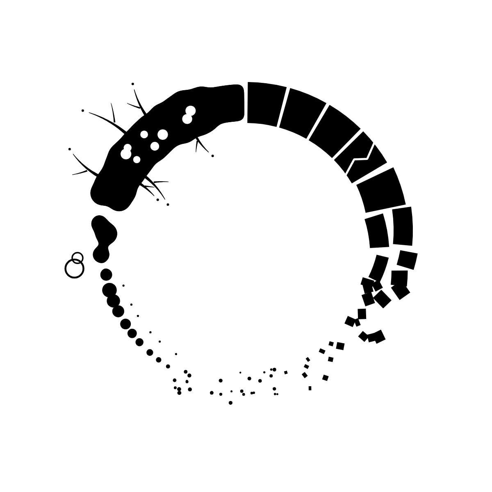

# The Ruin Daemon — an abstract language of communication

<p align="center"></p>

Interactive prototype for the ETAD project. The daemon of the artificial ruin
tries to communicate with a human, not through words but through an evolving
field of stains, blots, beads and veins. The participant reads this field and
answers by building with physical pieces.

## Running it

Open `index.html` in a recent Chrome, Edge, Firefox or Safari. You don't need
a build step, a server or any dependencies; it works offline. WebGL2 is required.

| Action | Effect |
|---|---|
| click / tap / Enter | wake the daemon; the configuration unfolds from where you touched |
| press & hold still on the board | offer attention at a point; nearby loci respond and nearby pieces grow faster |
| drag · scroll / pinch | turn around the board · come closer (left alone, the view turns slowly) |
| T (or "above") | look straight down, as in the flat version, and back |
| 1 – 5 | preset views: 1 orbit · 2 above · 3 low, at the height of the pieces · 4 side, along the board · 5 close up on a piece (press again for another) |
| C (or "cuts") | the camera cuts between the presets on its own every 8–15 s, creeping slowly inside each shot (an exhibition loop); dragging or zooming takes the camera back |
| Space | **hold**: freeze the daemon to study a configuration |
| N | a new session (the old body dissolves while a new one grows) |
| Esc | end the session |
| F | fullscreen |
| H | hide every mark; only the surface remains |
| D | observer's notes: a live readout of the daemon's state, for the team |
| V | switch between the TOUCH look (light points and lines in a dark space, with trails) and the painted look |
| W (or "cams") | webcams: read a real construction built with Jenga blocks (see below) |

Each session gets a 5-character code (top left, also written into the URL as
`?seed=XXXXX`). Opening that URL reproduces the same initial configuration and
the same dialect. Use it to compare or to present a specific session.

The small dot at the top left is the only signal of intent. **Filled**: the
daemon is speaking. **Hollow**: it is listening. The listening phase is the
moment for the participant to answer with the pieces.

## In three dimensions: the daemon grows its body

The surface lies on a board, and out of it the daemon grows its own pieces.
Nobody places them. Every session unfolds a different composition from the
seed and from the will's intention (`js/daemon/growth.js`), built the way
the workshop's Jenga models were: elongated stones, mostly standing, and
mostly chunky: cubes, short, thick and slab-like stones, only a few long
ones. Gates (two posts and a lintel, often slid off-centre),
posts stacked end on end, T's whose beam cantilevers out, totems of two or
three storeys crowned by a lone post, single standing stones; 15 to 25
stones in all. The
pieces rise one after another, and the upper ones only once what carries
them has grown. A few stray pieces grow where it does not want matter;
they irritate and, after a while, sink back into the surface.

The pieces are cut stones, never the same block twice: each has its own
character (crisp ashlar, chipped rubble, weathered, split), an uneven
section, a weathered surface, facets knapped off its edges and corners and
often a broken, slanted end. Its surface is stone (strata, grain, pits),
only stained by the daemon's pattern, and its worn edges catch the light.
At each stone's foot dark veins take root and spread like mycelium,
tapering and branching into ever finer hairs. Shadows are cast by the
pieces' real shapes (a shadow map) and softened like soot. The field is still painted exactly
as before (into a texture on the board, `js/render/scene.js`), and its
pattern continues onto the pieces:

- the ground's stains and veins are folded up the sides of each piece, and
  its cell tissue (walls thickening at junctions, nuclei) covers every facet
- only the sharp folds are inked, with a wobbling hand-drawn line
- the ground stays calm and clean, with no board edge; the field shows on it
  only as a few veins and stains spreading from where pieces are born
- shadows bleed into the ground like soot
- freshly grown matter is pale; a piece the will reads as excess irritates
  (red scratches, a shiver); accepted ones settle, with a faint moss

The body is reported to the will as the same 8 × 5 height map, so the loop
below now runs between the daemon and its own growth: lack stains gather
where it has not grown yet, and it settles as the form completes. The
participant watches, turns around it and offers attention.

## Building for real: two webcams

Press **W** (or "cams") to let the daemon read a real construction built with
Jenga blocks instead of growing its own body (`js/ui/cameras.js`).

- **top camera:** looks down on the building area and finds which of the
  8 × 5 cells hold blocks, by comparing with a picture of the empty area
- **side camera** (optional): looks at the front edge and measures how tall
  each of the 8 columns is, against one standing block. Without it every
  occupied cell counts as one standing block.

Setup: choose the two cameras; on the top view press "corners" and click the
building area's corners (back-left, back-right, front-right, front-left;
front is where the side camera stands); on the side view press "base" and
click the front edge's left end, its right end, and the top of one block
standing upright on the left end. Clear the area, press "empty" on both, set
the sensitivity, then tick **live**. A change only counts once the picture
has been still for about a second, so hands reaching in are ignored. On the
screen the daemon's body becomes a mirror of what you built, and the will
judges it exactly as before. The calibration is remembered in the browser.
The side camera can't tell rows apart, so all built cells in one column get
that column's height. Two webcams on one USB hub sometimes refuse to run
together; use separate ports.

## The beginning: the ruin's history in ten seconds

Every session first tells where the ruin comes from (`ruinFromModel()`,
`palace()`, `moveRuin()` and `caption()` in `js/daemon/growth.js`), with a few
words under the scene:

1. a short wall stands alone (the model's lowest stones)
2. beside it the palace rises: pale dressed blocks, rows of windows, a tower
3. 1774: the palace burns, blackens with soot and embers, and falls into a heap
4. its stones are carried along the ground to the wall and lifted into place,
   course by course: 1784, the ruin is built out of them (fresh pale stone)
5. ivy, rain, two hundred years: plants grow over it, the stones weather
6. in two seconds it falls, breaks, and becomes ground: where each stone broke,
   its grit stays on the ground, then creeps to where the daemon's body rises

## Trying to be human

Once its body has grown, the daemon wants to know what it is like to be human.
It cannot talk; it only has its stones, its weight and the ground
(`js/daemon/life.js`). Each cluster of stones becomes a being that tries what
makes us human:

- **vulnerability:** it stacks its stones into an upright body, wobbles, falls,
  lies there trembling, and slowly gets up. A fast movement near it makes it
  flinch and shrink back.
- **attachment:** beings that meet stay bonded, return to each other and breathe
  together; apart too long, one searches. One being attaches to the human: it
  follows the cursor over the ground, and when the human stops it waits there
  and leaves a ring that never fades.
- **imperfection:** it stumbles (smeared footprints), hesitates, follows the
  human a little wrong, answers tapped rhythms with hops but sometimes misses
  one, lifts its brush mid-stroke, and loses the beat while dancing.
- **mortality:** it tires and sleeps, sinking a little into the ground; its
  traces fade.
- and it plays: it walks, paints, dances; at rest its stones beat like a heart.

## The game: one human thing, built together

After its history the ruin becomes ground. Then, in the future, it tries to
understand one human thing per game (`js/daemon/game.js`). It cannot talk; it
shows the players a form to build together with real blocks (15 x 5 x 3 cm,
like Jenga) on the table in front of the screen. The next block glows where it
goes; the players place a real block there and tap the screen (or press Enter
or →). ← / Backspace takes one back. The dots show whose turn it is. When the
form is complete, it comes alive in its own way.

| game | colour | the form | what it asks of the players | when complete |
|---|---|---|---|---|
| attachment | purple | a six-sided ring tower; every block bridges two blocks below, laid by others | each player's pieces hold the others', like a puzzle | a wave runs round the ring |
| vulnerability | light blue | a tall, thin stack of cantilevers, each block balanced on the end of the last | to be gentle; it may fall | it trembles and sways |
| intimacy | red | a tight bundle of standing blocks pressed together on a tiny footprint | to come close, hands and bodies | it breathes with one heartbeat |
| curiosity | matrix green | a path branching out over the table, a block standing at each tip | to go out in new directions | a pulse runs out to the tips, which look around |
| imperfection | yellow | a wall built wrong on purpose: offsets, gaps, a block standing where it should lie | to place blocks badly, on purpose | blocks jump out of place and back |

Each new session plays the next game. `?game=intimacy` (etc.) fixes one, G
switches, `?players=4` or + / − sets the number of players.

## The ruin model

Every session opens with the ruin from its 3D model,
`assets/kuenstliche_ruine_weimar_game_ready.glb` (910 parts: wall stones,
window frames, the stone ball, ivy leaves and grass). Because a page opened
as a local file may not load a `.glb`, the model is converted to
`js/daemon/ruin-model.js` (same geometry and colours). To use a new model,
replace the `.glb` and regenerate that file. It is scaled to 0.9 wide on the
board and drawn in one pass (`syncRuin()` and `RUINM_*` in `scene.js`), with
weathering on the stones and shadows. Every part can move on its own.

It stands for about ten seconds. Then it collapses, without trembling:
from the west end the parts fall, break where they land, and each stone
leaves a small heap of stone-coloured grit on the ground (the plants fall
with them). Then the grit creeps along the ground to where the new stones
rise out of it (`ruinFromModel()`, `moveRuin()` and `moveDust()` in
`js/daemon/growth.js`). The ruin is not the daemon's body: the will never
reads it. Without the model file, a procedural ruin is built instead
(`ruin()`).

## The loop: intention, construction, negotiation

1. **Initiation:** touching the surface starts a session. The daemon fixes a
   **morphological intention** for the whole session (`js/daemon/will.js`).
   It wants to become a particular form, chosen deterministically from the
   seed among five archetypes:
   - `radial`: a centre with a ring and spokes
   - `tower`: one dominant tall point, sometimes with a smaller twin
   - `branching`: a trunk that forks into arms
   - `nucleus`: a dense core with scattered satellites
   - `constellation`: separate groups of different weight

   The intention is a target height map on the same 8×5 grid as the
   construction. It is **never drawn**.
2. **Expression:** the intention biases the abstract language. It shapes the
   initial composition, where matter gathers and grows, which forms and
   gestures the daemon prefers, and how compact or loose each area is.
   The field keeps evolving, but it gravitates toward its intended
   distribution.
3. **Interpretation and response:** the participant reads the surface, builds
   with physical pieces, and reports the construction on the grid. The grid
   covers the whole surface, top-down, so each cell is a region of the surface.
   Pointing at a cell lights its region.
4. **Communication:** the daemon compares the model with its intention. The
   comparison combines blurred cell-by-cell agreement with shape features
   (mass, centroid, spread, peak height, number of separate groups), so a
   near-miss counts partly. It produces:
   - **alignment** (0..1)
   - **precision**: is what was built wanted?
   - a spatial **error map**: *lack* (wants matter here), *excess* (rejects
     matter here) and *harmony* (agrees)
5. **Feedback:** both the visual and the acoustic feedback come from that one
   state:

   | where | surface | sound |
   |---|---|---|
   | it wants matter (lack) | an oxide-red stain gathers in that region; nearby loci tighten and are pulled toward it; insistent impulses excite it | low repeated thuds on that place, more and sharper as insistence rises |
   | it rejects matter (excess) | the tissue there irritates, with red-walled cells and agitated fibres; its own matter loosens and is pushed away | tight scraping rattles and hard taps |
   | it agrees (harmony) | the tissue softens and lightens, jitter calms, the vignette opens | soft rounded throbs |
   | a piece is placed or lifted | — | a wooden knock (taller stack = higher, harder) |
   | about 0.5 s later, its judgement | *closer*: calm; *further*: excitation and a red flash ripple | a throb, or a double hard tap and scrape |
   | sustained agreement (accord) | it speaks less and listens longer | three slow throbs |

   **Insistence** rises with misalignment, mostly with *wrong* matter rather
   than *unfinished* matter. It also rises with **urgency**, which grows when
   nothing improves and falls when things do. Insistence sets how often
   impulses happen, how hard they are, and how sharp every sound is. When it
   is high, the `demand` gesture takes over: the daemon works directly on the
   most misaligned place, reaching out and growing matter there or pushing
   its own matter away.
6. **Negotiation:** the daemon does not simply reward compliance, and it is
   not converted. If a deviation is held for a long time (more than 18 s), it
   absorbs part of it, bounded by its per-session *plasticity* (0.15–0.35),
   and more readily when the deviation is next to its own intention. If a
   demand is ignored for a long time, it softens a little. The intention
   never becomes the participant's construction.

The loop continues until accord is reached or the session is ended.

## The language

The visual system was derived from the three images in `References/`:

- **1.jpg (marbling):** cells of colour held by dark membranes that thicken
  at junctions, with light veins running through the dark masses.
- **2.jpg (sprayed ink):** soft blots of very different scales, aligned along
  a direction, with fibrous halos.
- **3.jpg (ink dots):** strings of graded beads, fine dotted companion lines,
  overlapping transparent circles.

- **image.png (main direction):** neural, mycelial networks. It shows bubbly
  cell tissue, dark veins tapering into fine branching filaments, cream fibres
  crossing dark masses, and moss, olive and bronze tones on linen.

These were translated into abstract matter rather than drawn literally.

### Network (veins, dendrites, tissue)
Lines are not drawn on top of the stains; they are made of the same matter.
Every vein casts a soft, blurred shadow into the ground, free dendrite tips
fade out, and a dendrite that seeks its neighbour joins it: it thins in the
middle and swells as it enters the other stain. Cream fibres are wide, soft
and translucent.

- **Veins:** links between clusters are drawn as tapered lines that thicken
  where they meet a cluster and swell as pulses travel along them.
- **Dendrites:** each cluster grows branching filaments. They extend when it is
  fed or excited and pull back when it is calm. Some bend toward the nearest
  neighbour, so separate stains seem to reach for each other. A few are cream
  fibres instead of dark veins.
- **Tissue:** a layer of irregular, bubbly cells (two scales, thicker at the
  junctions) grows wherever there is matter. The cell walls are dark on light
  ground and cream inside dark masses. A faint ghost of the tissue stays where
  matter used to be.

### Matter (5 kinds)
| | | |
|---|---|---|
| **ink** | dense, opaque | merges with neighbours like liquid: close spots become one mass, separated spots become dots |
| **wash** | diffuse tonal field (moss ↔ bronze, depending on the palette) | uneven pigment load, broken tide lines at its edge |
| **ring** | transparent circle with a pooled rim | overlaps accumulate |
| **soot** | soft dark spray | fibrous edges aligned with the daemon's current axis |
| **segment** | tapered vein (dark) or fibre (cream) | used for links and dendrites |

### Words: loci and their characters
A **locus** (cluster) is a concentration of matter with a *mass*, an
*orientation*, a *density* (compact ↔ dispersed) and an *activation*. It holds
itself in one of five characters:

- `blot` — a heavy merged mass with thrown droplets (2.jpg)
- `spray` — graded spots dispersed along a direction (2.jpg)
- `string` — beads on a line, a fine dotted companion, rings (3.jpg)
- `pool` — overlapping transparent circles with small dots inside (3.jpg)
- `cell` — a terracotta void held by a membrane of merged beads (1.jpg)

Detail depends on mass: a starving locus shows only its skeleton, while a fed one
grows its full form. When a locus changes character, its existing spots take
on the new roles, so the form *morphs* and is never swapped.

### Connections
Loci are linked by chains of ink beads. A strong link merges into a continuous
vein. A weak link breaks into a dotted line. A dissolved link evaporates. Matter
flows along links, so when one stain grows another shrinks. Activation travels
along links as visible pulses: a locus that is excited passes the excitation
on to its neighbours, and the whole field thinks collectively.

### Grammar: gestures, phrases, listening
The daemon speaks in **phrases** of 3–5 overlapping **gestures**, then
**listens** (the field calms, slows and contracts) for 8–15 s:

`converge` · `divide` · `reach` · `release` · `insist` · `realign` ·
`transmute` · `link` · `sever` · `migrate` · `demand` (only once pieces are reported)
(see `js/daemon/mind.js` for what each one does).

### Dialects
Each seed unfolds into a **temperament**: a pigment set, preferred characters,
favoured gestures, tempo, a dominant axis and its coherence. Different sessions
therefore speak different dialects of the same language.

### Sound
**Switched off for now:** `main.js` creates no synth or sonifier and the
sound controls are hidden. The code in `js/sound/` is kept for later.

Sound is made of short, dry, independent percussive events (a lightly
saturated master; everything below 120 Hz is cut, so nothing rumbles):
`click`, `tap`, `knock`, `thud` (a heavy block set down on stone, with no
low sine or pitch glide), `pulse` (a soft breath of high noise, like a brush
over paper) and `rattle` (irregular contacts). It is synthesized in the browser with no samples. There are no
melodies, held notes, loops, tempo, drone, reverb or delay. A sound happens
only when something happens:

| Event | Sound |
|---|---|
| a pulse arrives at a locus | thud (heavier locus = lower) |
| a pulse leaves along a vein | click |
| a locus fires | depends on its form: blot a thud, spray a rattle, string two taps, pool a hollow knock, cell a throb |
| a vein grows a bead | a tiny tap |
| a new locus emerges | a soft throb |
| two loci link | two small knocks |
| a locus dissolves | a falling, sparse rattle |
| `insist` beats | thuds |
| the will's impulses, pieces, responses, accord | see the feedback table above |

The will's insistence sets how loud the daemon's own events are, how dense
they are (each voice has a minimum gap that shrinks as insistence rises) and
how sharp they are (attack, brightness, shortness). Misaligned means
intense, frequent, repetitive and sharp; aligned means soft, sparse and
rounded. Repetitions are spaced irregularly, so they never form a rhythm.
Sounds are panned by their position on the surface. Audio starts only after
the first click. Mute with M or "sound"; set the level with the slider.

### Memory
The surface remembers. A low-resolution buffer keeps a slowly fading trace of
where matter has been (around 40 s), so earlier states remain as faint stains in
the paper, even across sessions.

## Architecture

```
index.html
css/daemon.css
js/
  core/      random.js (seeded RNG, session codes) · noise.js · emitter.js
  daemon/    palette.js      earth pigments (+ the oxide-red signal colour)
             ruin-model.js   the Künstliche Ruine's 3D model, from assets/*.glb
             will.js         the intention, the model, evaluation, negotiation
             growth.js       the body: pieces grown from the intention, every session anew
             temperament.js  seed → dialect (reshaped by the will)
             forms.js        the vocabulary (5 characters)
             organism.js     body: loci, spots, bonds, physics, flows
             composition.js  initial configuration of a session
             mind.js         grammar: gestures, phrases, listening
             daemon.js       public API (the only thing other modules use)
  render/    shaders.js · renderer.js   WebGL2 painting (tile-binned field → surface texture)
             scene.js        the 3D board, organic piece meshes, soot shadows, camera
  sound/     synth.js        dry percussive voices (click, tap, knock, thud, pulse, rattle)
             sonifier.js     event → sound, shaped by the will's insistence
  ui/        interface.js    threshold, marks, keyboard, pointer, volume, notes
             view.js         turning around the board, attention, the view from above
  main.js    wiring
```

The daemon knows nothing about rendering or the DOM. Everything passes through
`js/daemon/daemon.js`:

```js
daemon.begin({ seed, origin })   // start / restart a session
daemon.end()
daemon.stimulate(x, y, amount)   // external signal at a point (world units)
daemon.place(i, j, +1 | -1)      // a piece added / removed at a grid cell
daemon.clearModel()              // the physical model was taken apart
daemon.describe()                // semantic snapshot (see below)
daemon.on('phase', fn)           // 'session:start' | 'session:end' | 'dormant' |
                                 // 'phase' | 'gesture:start' | 'gesture:end' | 'stimulus' |
                                 // 'piece' | 'response' | 'impulse' | 'will:accord' | 'will:discord'
```

The intention is kept separate from its expression. `will.js` is pure
logic: it has no rendering, sound or DOM. It exposes a target, an
evaluation, an error map, insistence and impulses, and everything else only
reads them. It can be replaced by a learning agent with the same interface,
and the grid can be replaced by a camera or sensors that call `place()`.

`daemon.describe()` returns what the daemon is currently "saying" as data:
loci (normalised position, mass, character, density, activation, orientation,
links), links (strength, continuous or dotted, flow) and the will (intention,
alignment, insistence, urgency, accord, focus cells, pieces). The observer's
notes (D) also print the target, for the team only. The participant never
sees it. The instance is exposed as `window.daemon` for console experiments.
